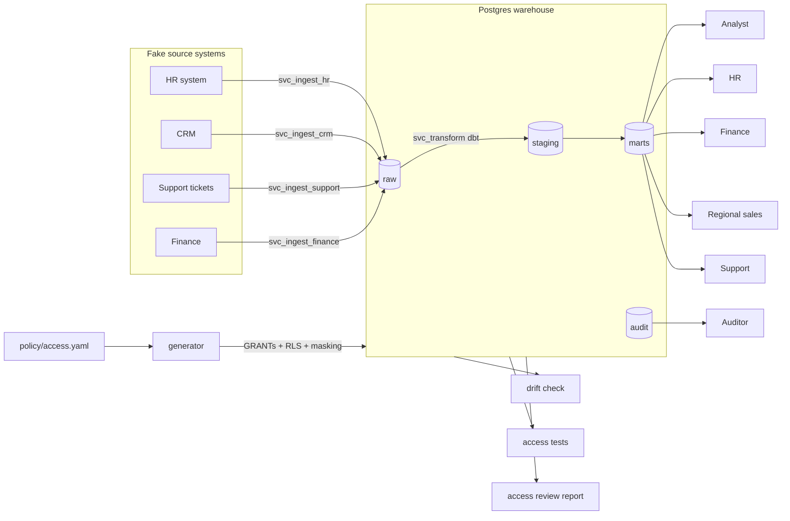

# SystemArch: a governed data warehouse

A small Postgres warehouse where access control is the point. Four fake source systems load into one warehouse, and every person and service account gets only the access it needs. That access is enforced in the database itself (grants, column masking, row-level security) and generated from a single policy file. Tests, drift detection and an access review report then prove who can see what.

Where I am: Phase 3 is under way. `just test` logs in as every person and service account and checks the database does exactly what the policy says, plus separation of duties. `just drift` lists anything changed behind the policy's back. Next up is running it all in CI.



## Running it

You need Python 3.11+, [just](https://github.com/casey/just) and a Postgres to point at. I use a Supabase free project, see [ADR-001](docs/decisions/0001-where-the-warehouse-runs.md).

```
copy .env.example .env    # fill in the connection details
just setup                # virtualenv and dependencies
just up                   # check the connection
just seed                 # apply policy, generate data, ingest, build marts
just test                 # access tests as each person, SoD, drift
just drift                # what differs between the database and the policy
```

`just plan` shows the SQL the policy turns into without running it. Run `just` on its own to see every command.

## Layout

`policy/access.yaml` is the single source of truth for access, and `policy/people.yaml` stands in for the identity provider. `generator/` turns them into SQL, and `ddl/governance.sql` holds the functions that re-apply access every time dbt rebuilds a table. `ddl/` holds the raw table definitions, `seed/` the fake data generators, `ingest/` one loader per source, and `dbt/` the staging and mart models.

The reasoning behind each choice is in [docs/decisions](docs/decisions/README.md).

## How changes get in

`main` is protected. Every change goes through a pull request, review comments have to be resolved before it can merge, and PRs are squash-merged so history stays one commit per change. Force pushes and deleting `main` are blocked for everyone, me included. Secret scanning with push protection, Dependabot alerts and private vulnerability reporting are on.

## Credits

Built with [Claude Code](https://claude.com/claude-code), which drafted options and code. The decisions are mine.
