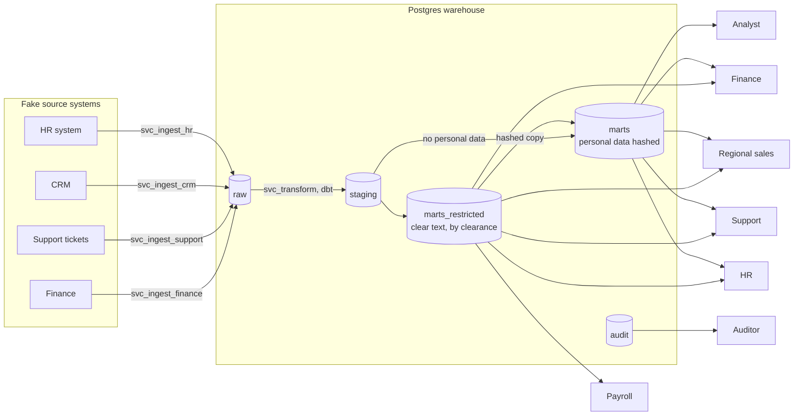
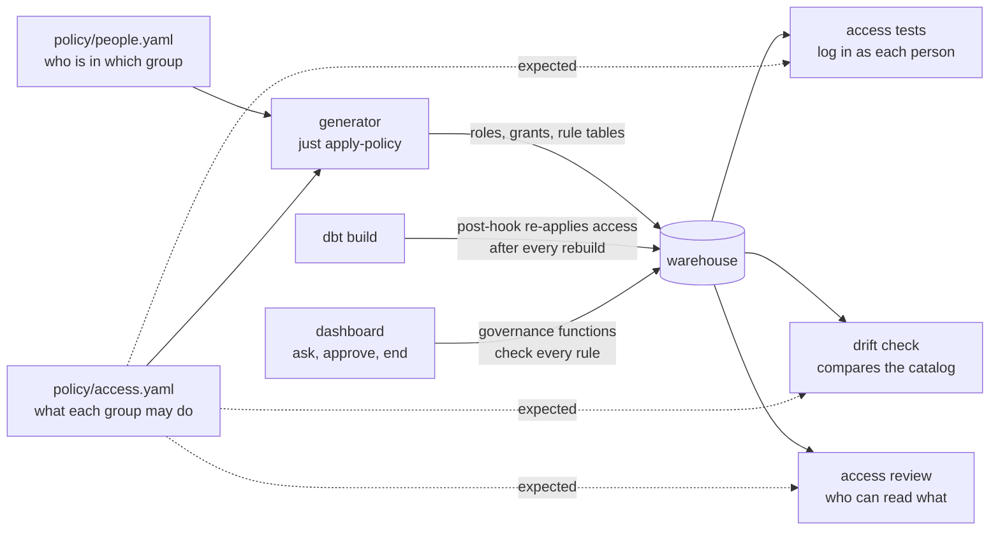
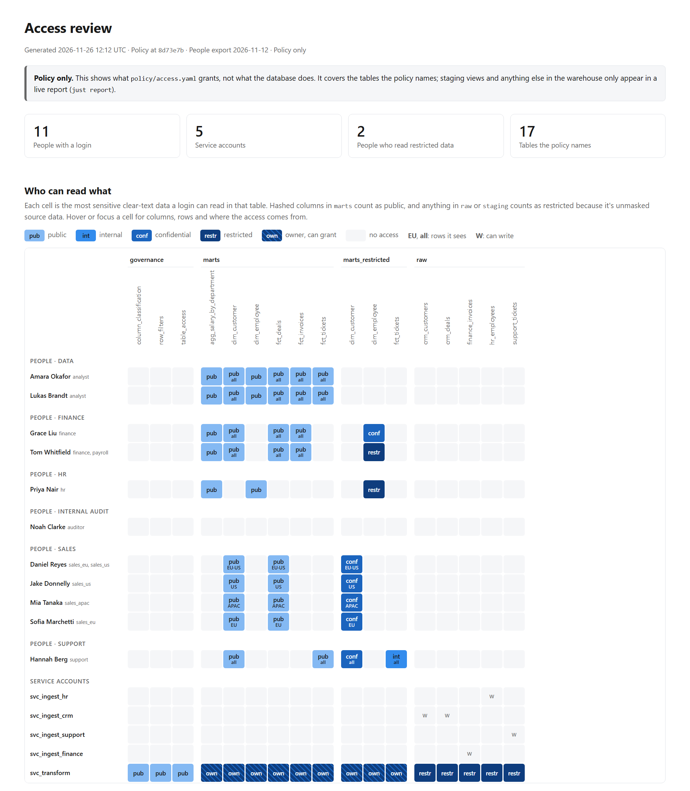
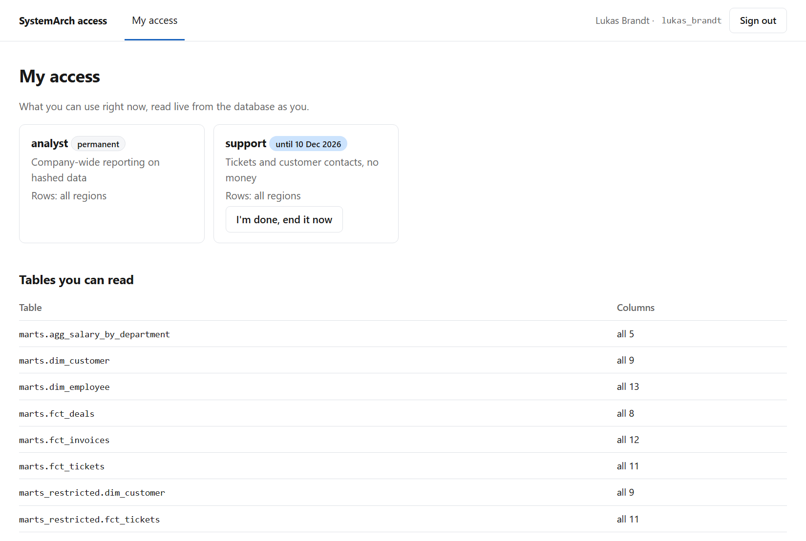
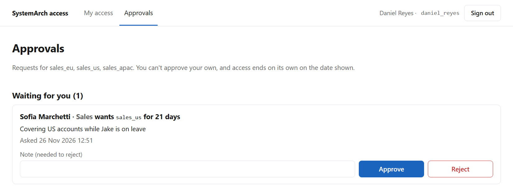

# SystemArch: a governed data warehouse

A small Postgres warehouse where access control is the point. Four fake source systems load into one warehouse, and every person and service account gets only the access it needs. That access is enforced in the database itself (grants, column masking, row-level security) and generated from a single policy file. Tests, drift detection and an access review report then prove who can see what.




Access is never granted by hand. Two YAML files describe it, the generator turns them into SQL, and three independent checks read the result back from the database. Temporary group membership can also be asked for in the dashboard, and the database grants it once an approver says yes.



Everything is enforced inside Postgres, in layers. Each one is driven by a part of the policy:

| Layer | What it limits | Set in `access.yaml` | ADR |
|---|---|---|---|
| Group roles | Who holds which job role. People never hold service roles | `roles`, plus groups in `people.yaml` | [007](docs/decisions/0007-identity-model.md) |
| Grants | Which schemas and tables a role can read or write | `schemas`, `tables` | [004](docs/decisions/0004-enforcement-point.md) |
| Column clearance | Which clear-text columns a role sees in `marts_restricted` | `classification`, `clearance` | [013](docs/decisions/0013-pii-classification.md) |
| Hashing | Personal data in `marts` is a salted hash, so joins work but values don't leak | `classification` | [005](docs/decisions/0005-column-protection.md) |
| Row security | Which regions' rows a role sees | `row_filters`, `regions` | [006](docs/decisions/0006-row-filtering.md) |

## The access review

`just report` writes one HTML page in `report/out/`: every login against every table, showing the most sensitive data each can read unhashed, the regions it sees and whether it can write. Any cell where the database differs from the policy is marked red. Below the matrix it lists who reads each sensitive column, each person's access in full, and a sign-off block for the reviewer. CI attaches the latest one to every run.

<picture>
  <source media="(prefers-color-scheme: dark)" srcset="docs/images/access-review-dark.png">
  
</picture>

## Asking for access

`just dashboard` opens a small site on your machine. You sign in as yourself and ask for a group with a reason and a number of days. One of that group's approvers approves or rejects it, and approved access ends on its own date. Who approves each group, and for how long at most, is set in `access.yaml` ([ADR-009](docs/decisions/0009-who-approves-access.md)).

The dashboard only shows things and passes on clicks. The rules (only that group's approvers decide, never your own request, a reason for every rejection) live in database functions that see you as the login you signed in with, so the same rules hold from any SQL client.

| You see your access, and what's temporary | An approver decides |
|---|---|
|  |  |

## Running it

You need Python 3.11+, [just](https://github.com/casey/just) and Postgres 16 or newer to point at (the role grants use `WITH SET` / `WITH INHERIT`). I use a Supabase free project, see [ADR-001](docs/decisions/0001-where-the-warehouse-runs.md).

```
copy .env.example .env    # fill in the connection details
just setup                # virtualenv and dependencies
just up                   # check the connection
just seed                 # apply policy, generate data, ingest, build marts
just test                 # access tests as each person, SoD, drift
just drift                # what differs between the database and the policy
just report               # access review page in report/out
just dashboard --demo     # ask for and approve access on http://127.0.0.1:5000
```

`just plan` shows the SQL the policy turns into without running it. Run `just` on its own to see every command.

## Using it

Temporary access to a group goes through the dashboard. Everything else is an edit to `policy/`, reviewed in a pull request. Nobody runs a `GRANT` by hand, and if they do, `just drift` and the tests catch it.

**Someone needs a group for a while.** They ask in the dashboard, and an approver decides there. No pull request.

**Someone joins.** Add them to `policy/people.yaml` with the groups their job always needs. Their login is their id with an underscore (`ana.silva` becomes `ana_silva`).

```yaml
  - id: ana.silva
    name: Ana Silva
    department: Sales
    groups: [sales_eu]
```

Then `just plan` to see the SQL, open a PR, and once it's merged `just apply-policy` creates the login and a password in `.env`.

**Someone leaves.** Delete their entry. The next `just apply-policy` takes away their login and groups but keeps the role, so the audit trail still has a name.

**Change what a group can do, or who approves it.** Edit the group under `roles:` in `policy/access.yaml`. A group that reads a region-filtered table must say which `regions:` (a list, or `all`). A group reading `marts_restricted` gets a `clearance:` level, and sees only columns at or below it.

```yaml
  support:
    regions: all
    tables:
      marts_restricted.fct_tickets: {privileges: [SELECT], clearance: internal}
    request: {approvers: [hannah.berg], max_days: 90}
```

**Add a column with personal data.** Every column of a `marts_restricted` table needs a level under `classification:`, and `just test` fails until it has one. Once it's classified, dbt hashes it in the `marts` copy and only roles with enough clearance see it in `marts_restricted`.

**Review access.** Run `just report`, open the page in `report/out/`, check each person's access is still needed, and sign it off. `just report --policy-only` shows what a policy change would grant before it's applied, with no database needed.

**Something was changed by hand.** `just drift` lists every difference from the policy, and `just apply-policy` puts it back. If the change was wanted, put it in the policy first.

## Layout

`policy/access.yaml` is the single source of truth for access, and `policy/people.yaml` stands in for the identity provider. `generator/` turns them into SQL, and `ddl/governance.sql` holds the functions that re-apply access every time dbt rebuilds a table. `ddl/requests.sql` holds the access request rules. `ddl/` also holds the raw table definitions, `seed/` the fake data generators, `ingest/` the loader that runs each source as its own account, `dbt/` the staging and mart models, `drift/` the drift check, `report/` the access review and `dashboard/` the request site.

The reasoning behind each choice is in [docs/decisions](docs/decisions/README.md).

## How changes get in

`main` is protected. Every change goes through a pull request, review comments have to be resolved before it can merge, and PRs are squash-merged so history stays one commit per change. Force pushes and deleting `main` are blocked for everyone, me included. Secret scanning with push protection, Dependabot alerts and private vulnerability reporting are on.

## Credits

AI tool used: [Claude Code](https://claude.com/claude-code).
