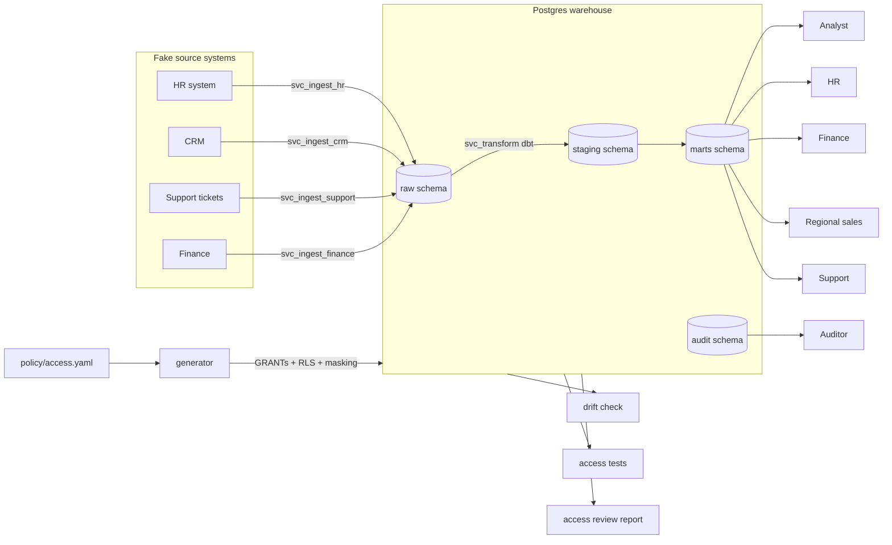

# Governed Data Warehouse

A small Postgres warehouse where **access control is the product**. Several fake source systems land data into one warehouse. Every human and service account gets least-privilege access, enforced in the database (grants, column masking, row-level security) and generated from a single policy file. Automated tests, drift detection and an access review report **prove** who can see what.

> Status: **Phase 0** (repo and environment)

## Architecture



## Quickstart

Prerequisites: Python 3.11+, [`just`](https://github.com/casey/just) (`winget install Casey.Just`), and a Supabase project (see [ADR-001](docs/decisions/0001-where-the-warehouse-runs.md)).

```powershell
copy .env.example .env      # then fill in the Supabase session-pooler details
just setup                  # create .venv and install dependencies
just up                     # verify the warehouse is reachable
just seed                   # Phase 1
just apply-policy           # Phase 2
just test                   # Phase 3
just report                 # Phase 4
```

## Decisions

All design decisions are recorded as ADRs in [`docs/decisions/`](docs/decisions/README.md).
